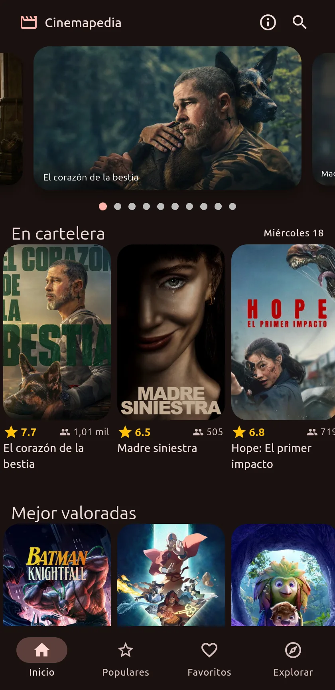
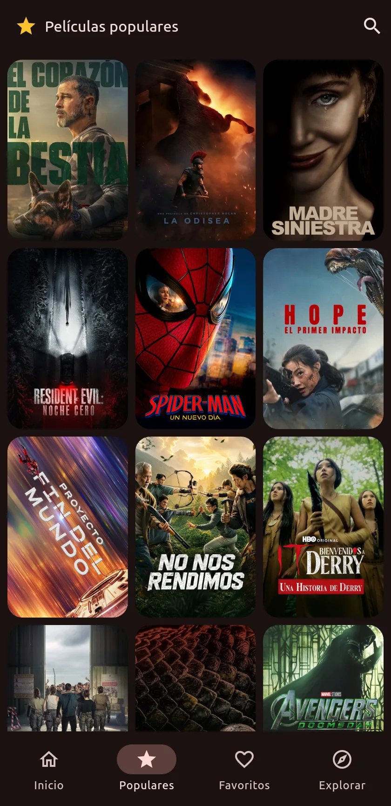
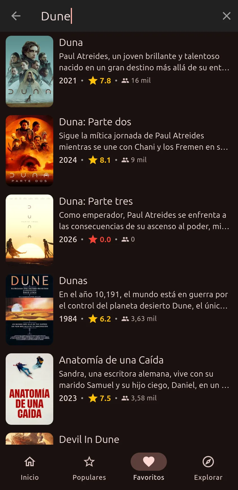
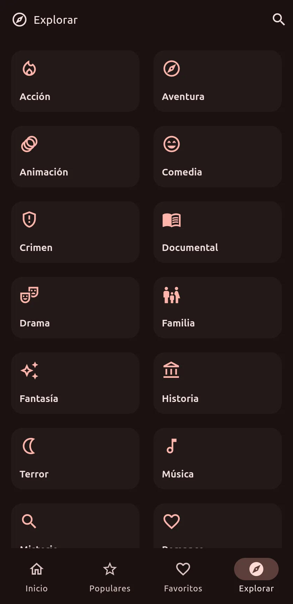

# cinemapedia

Catálogo de películas de TMDB: cartelera, populares, favoritos y trailers. Hecha con Flutter para Android, iOS, Linux, Windows y macOS.

<div align="center">

| Inicio | Detalle | Populares |
|:---:|:---:|:---:|
|  |  |  |

| Favoritos | Buscador | Explorar |
|:---:|:---:|:---:|
|  |  |  |

</div>

**Índice:** [1. Documentación](#doc) · [2. Variables de entorno](#env) · [3. Isar Database](#isar) · [4. API - The Movie DB](#tmdb) · [5. Ayuda](#ayuda) · [6. Tests y CI](#ci) · [7. Iconos y capturas](#assets) · [8. Compilación y distribución](#build)

<a id="doc"></a>

## 📚1. Documentación

### 1.1 Descripción de la Aplicación

Cinemapedia permite explorar el catálogo de **TMDB**: cartelera, populares, películas por género, búsqueda y favoritos, con el detalle de cada título (sinopsis, elenco, fechas de lanzamiento) y sus trailers. La información se obtiene de la API de TMDB; los trailers se reproducen dentro de la app (en móvil, con el reproductor oficial de YouTube). Está hecha con Flutter y corre en Android, iOS, Linux, Windows y macOS.

### 1.2 Bibliotecas y Dependencias Utilizadas

Las versiones exactas viven en `pubspec.yaml`; aquí se resume para qué sirve cada una:

| Paquete | Categoría | Para qué se usa |
| --- | --- | --- |
| `flutter_riverpod` | Estado y navegación | Gestión de estado y providers |
| `go_router` | Estado y navegación | Navegación declarativa entre pantallas |
| `dio` | Red y datos | Cliente HTTP para la API de TMDB (con timeouts y errores mapeados a dominio) |
| `flutter_dotenv` | Red y datos | Carga de la API key desde el archivo `.env` |
| `isar` + `isar_flutter_libs` | Red y datos | Base de datos local (NoSQL) para las películas favoritas |
| `cached_network_image` | UI y multimedia | Caché en disco y memoria para pósters e imágenes |
| `card_swiper` | UI y multimedia | Carruseles de tarjetas (cartelera) |
| `media_kit` + `media_kit_video` | UI y multimedia | Reproductor de video embebido en escritorio (con los `media_kit_libs_*` de cada plataforma) |
| `youtube_explode_dart` | UI y multimedia | Extrae el stream público de YouTube para reproducir trailers en escritorio |
| `youtube_player_flutter` | UI y multimedia | Reproductor de los trailers en Android e iOS |
| `flutter_localizations` | Localización | Widgets de Material al español |
| `intl` | Localización | Formateo de fechas y números |
| `package_info_plus` | Sistema y utilidades | Versión y build de la app en runtime (diálogo "Acerca de") |
| `path_provider` | Sistema y utilidades | Directorios del sistema para el caché de imágenes y los datos locales |
| `share_plus` | Sistema y utilidades | Compartir enlaces de películas desde la app |
| `shared_preferences` | Sistema y utilidades | Historial local de búsquedas recientes |
| `url_launcher` | Sistema y utilidades | Abrir YouTube y otros enlaces externos en el navegador del sistema |
| `build_runner` | Desarrollo (`dev_dependencies`) | Ejecuta la generación de código |
| `isar_generator` | Desarrollo | Genera el código de las colecciones de Isar |
| `flutter_lints` | Desarrollo | Reglas de lint (`analysis_options.yaml`) |
| `flutter_test` + `integration_test` | Desarrollo | Tests unitarios, de widgets e integración |

> **Nota:** `card_swiper` **no** se usa desde pub: hay una copia local parcheada en `packages/card_swiper` (vía `dependency_overrides`) que corrige un error de precisión al redimensionar ventanas en desktop. El detalle está en `packages/card_swiper/PATCHES.md`; si actualizás el paquete, revisá ese parche.

> **Plataformas soportadas:** Android e iOS como experiencia base (player embebido de YouTube). En Linux/Windows/macOS la app funciona completa: los trailers se reproducen **dentro de la app** con `media_kit`, extrayendo el stream público de YouTube con `youtube_explode_dart` (mismo mecanismo que usan reproductores open source como NewPipe o yt-dlp). Es una solución no oficial: si YouTube cambia su backend puede dejar de funcionar, y en ese caso la pantalla ofrece **"Ver en YouTube"** para abrir el video en el navegador del sistema.
>
> **Requisitos para compilar en Linux:** `media_kit` enlaza contra el libmpv del sistema. En Ubuntu/Debian: `sudo apt install libmpv-dev` (ya vienen `libepoxy-dev` y las GTK que usa Flutter).

### 1.3 Estructura del Proyecto

```text
lib/
├── common/     # estados y widgets transversales
├── config/     # tema, router, constantes, responsive y soporte por plataforma
├── data/       # datasources, modelos, mappers y repositorios (TMDB + Isar)
├── domain/     # entidades, excepciones y contratos de datasource/repositorio
├── features/   # pantallas: home, movie_details, popular, favorites, genres, person
├── providers/  # providers de Riverpod
└── shared/     # widgets, servicios y delegates reutilizables (búsqueda)
```

---

<a id="env"></a>

## 💻2. Variables de entorno

La app lee la API key de TMDB de un archivo `.env` en la raíz del proyecto (empaquetado como asset). Se crea a partir del ejemplo:

```sh
cp example.env .env
```

```sh
# Contenido de example.env
THE_MOVIE_DB_API_KEY=your_api_key
```

Reemplazá `your_api_key` por tu API key (ver §4). El código que la lee está en `lib/config/constants/environment.dart`.

> **Nota de seguridad:** `.env` se empaqueta dentro del binario para que la app lea la API key de TMDB. Restringí la key desde la consola de TMDB (por referrer/paquete) para evitar usos indebidos.

---

<a id="isar"></a>

## 💾3. Isar Database

Base de datos local (NoSQL) para las películas favoritas (<https://isar.dev/es/>). Después de crear o modificar una colección, regenerá el código:

```sh
dart run build_runner build --delete-conflicting-outputs
```

Guía oficial: <https://isar.dev/es/tutorials/quickstart.html>

---

<a id="tmdb"></a>

## 📀4. API - The Movie DB

- Iniciar sesión en la página
- Ir al menú de **ajustes**
- Ir a la sección de **API**
- Crear o generar una **API KEY**
- Copiar esa API KEY en el archivo `.env` (ver §2)

URL de la API: <https://www.themoviedb.org/>

Documentación de desarrollo: <https://developer.themoviedb.org/docs/getting-started>

Referencia de endpoints: <https://developer.themoviedb.org/reference/intro/getting-started>

---

<a id="ayuda"></a>

## ⛑️5. Ayuda

### 🗺️5.1 Guías

**Comillas simples en vez de dobles:**

Abrir el archivo de `analysis_options.yaml` y establecer la siguiente configuración:

```sh
include: package:flutter_lints/flutter.yaml

linter:
  rules:
    prefer_single_quotes: true # Aquí se habilita
```

```sh
# Analizar el código y ver los problemas encontrados por el linter
flutter analyze

# Corregir automáticamente las correcciones sugeridas (ej: Comillas simples por dobles)
dart fix --apply
```

---

### ⌨️5.2 Comandos

```sh
# Instalar los paquetes o dependencias
flutter pub get

# Compilar y ejecutar la aplicación en un dispositivo conectado o emulador
flutter run
```

```sh
# Limpiar temporales
flutter clean

# Ejecutar el doctor para validar si todo está correcto
flutter doctor
```

---

<a id="ci"></a>

## 🧪6. Tests y CI

```sh
# Los mismos chequeos que corre la CI en cada push y pull request
flutter analyze                                           # sin issues
dart format --output=none --set-exit-if-changed .         # formato estable
flutter test                                              # tests unitarios y de widgets
```

El workflow de GitHub Actions (`.github/workflows/ci.yml`) ejecuta esos tres comandos en cada push y pull request. Tras cambiar las colecciones de Isar, regenerá el código (ver §3).

Los tests de integración viven en `integration_test/` y se ejecutan con `flutter drive` sobre un dispositivo real (no corren en la CI; ver §7.2 para las capturas del README).

---

<a id="assets"></a>

## 🎨7. Iconos y capturas

### 🖼️7.1 Iconos

La identidad visual de la app vive en `brand/` como fuente única:

- `brand/icon.svg` → tile de la app (fondo `#1E293B` + claqueta en `#B3261E`).
- `brand/mark.svg` → solo la claqueta, con `currentColor` (adaptive icon y monochrome de Android).

Los PNG/ICO de cada plataforma (Android, iOS, macOS, Windows y web) se generan desde esos SVG:

```sh
# Requiere Google Chrome/Chromium + Python 3 con Pillow
./scripts/generate-icons.sh
```

> **Importante:** los archivos generados se commitean, pero **no se editan a mano**. Para cambiar el icono se edita `brand/` y se vuelve a ejecutar el script (es idempotente: dos corridas producen los mismos archivos). Linux queda fuera porque el template de este repo no define icono de ventana (el launcher del `.deb` usa el PNG generado en `web/icons/`).

### 📸7.2 Capturas del README

Las capturas de `docs/screenshots/` (las del inicio de este README) se generan con:

```sh
# Requiere flutter con soporte de escritorio Linux, conexión a Internet
# y Python 3 con Pillow (igual que generate-icons.sh)
./scripts/capture-screenshots.sh
```

El script ejecuta un test de integración (`integration_test/screenshots_test.dart`) que corre la app real en una ventana, la navega con toques (inicio, detalle, populares, favoritos, buscador y géneros) y captura el árbol de render en tamaño de teléfono y tema oscuro, sin importar la ventana ni el tema del sistema. Al final convierte los PNG a WebP para que el README no pese de más.

> **Importante:** las capturas se commitean, pero **no se editan a mano**. Para actualizarlas se vuelve a ejecutar el script (el contenido depende del catálogo vigente de TMDB).

---

<a id="build"></a>

## 🚀8. Compilación y distribución

### 🔢8.1 Versionamiento

La versión vive en `pubspec.yaml` con el formato de Flutter `x.y.z+número de build` (ej: `0.2.0+3`):

- **`x.y.z`** → versión visible para el usuario. Se cambia con los flags del script cuando hay cambios importantes.
- **`+N`** → número de build (`versionCode` en Android). Se incrementa automáticamente en cada release.

```sh
# Subir el número de build (0.2.0+3 -> 0.2.0+4)
./scripts/bump-build.sh

# Cambios visibles para el usuario (reinician el número de build en 1)
./scripts/bump-build.sh --patch   # 0.2.0+3 -> 0.2.1+1
./scripts/bump-build.sh --minor   # 0.2.1+1 -> 0.3.0+1
./scripts/bump-build.sh --major   # 0.3.0+1 -> 1.0.0+1
```

La versión se propaga sola a cada plataforma: Android la usa como `versionName`/`versionCode`, y en escritorio Flutter escribe un `version.json` dentro del bundle. La app la muestra en el diálogo **"Acerca de"** (ícono ⓘ en la barra superior), lo que ayuda a saber qué build tiene instalada cada persona.

Los scripts de release (`build-apk.sh` / `build-deb.sh`) invocan el bump automáticamente antes de compilar. Si querés publicar el APK y el `.deb` con **el mismo** número de build, compilá el segundo con `--no-bump`. El bump modifica `pubspec.yaml`: commiteá el cambio junto al release (opcionalmente con un tag `git tag v0.2.0`).

### 🤖8.2 Android — APK

**Requisitos:** `flutter` en el PATH y el Android SDK configurado (`flutter doctor`).

```sh
# Compilar el instalador (incrementa el número de build y compila en release)
./scripts/build-apk.sh

# Variante: compilar sin cambiar la versión
./scripts/build-apk.sh --no-bump
```

El instalador queda en `dist/cinemapedia-<versión>-android.apk` (un solo APK con todas las arquitecturas).

```sh
# Instalar en un dispositivo/emulador conectado
adb install dist/cinemapedia-*-android.apk
```

También se puede copiar el APK al teléfono y abrirlo desde el gestor de archivos (habilitando la instalación de "orígenes desconocidos").

> **Firma:** por ahora la release se firma con las llaves de debug (ver `android/app/build.gradle`), lo que alcanza para instalar manualmente. Para publicar en Google Play hace falta un keystore propio y configurar `key.properties`.

> **Toolchain Android:** el proyecto usa AGP 9.1 + Gradle 9.3.1 (los del template de Flutter 3.47), compatibles con Java 21. `android/build.gradle` completa automáticamente el `namespace` de los plugins viejos que no lo declaran (p. ej. `isar_flutter_libs` 3.x), que AGP 8+ exige.

### 🐧8.3 Linux — `.deb`

**Requisitos:** `flutter` con soporte de escritorio, el paquete `dpkg` (aporta `dpkg-deb`) y las dependencias de compilación de `media_kit` (Ubuntu/Debian: `sudo apt install libmpv-dev`).

```sh
# Compilar y empaquetar (incrementa el número de build, compila y genera el .deb)
./scripts/build-deb.sh

# Variante: empaquetar sin cambiar la versión
./scripts/build-deb.sh --no-bump
```

El paquete queda en `dist/cinemapedia_<versión>_<arquitectura>.deb`.

```sh
# Instalar (apt resuelve las dependencias de runtime)
sudo apt install ./dist/cinemapedia_*_*.deb

# Desinstalar
sudo apt remove cinemapedia
```

El paquete instala el binario y sus librerías en `/opt/cinemapedia/`, un symlink en `/usr/bin/cinemapedia`, el acceso del menú de aplicaciones (`com.example.cinemapedia.desktop`) y el icono del launcher (el PNG de `web/icons/`). Las dependencias del `control` se calculan automáticamente con `readelf` + `dpkg -S` sobre las librerías que enlaza el bundle, por lo que reflejan la distro donde se compila.
